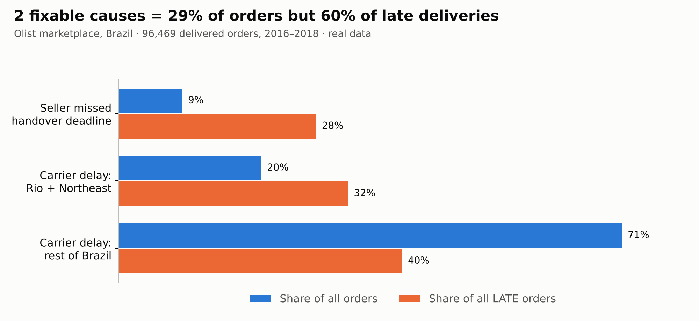
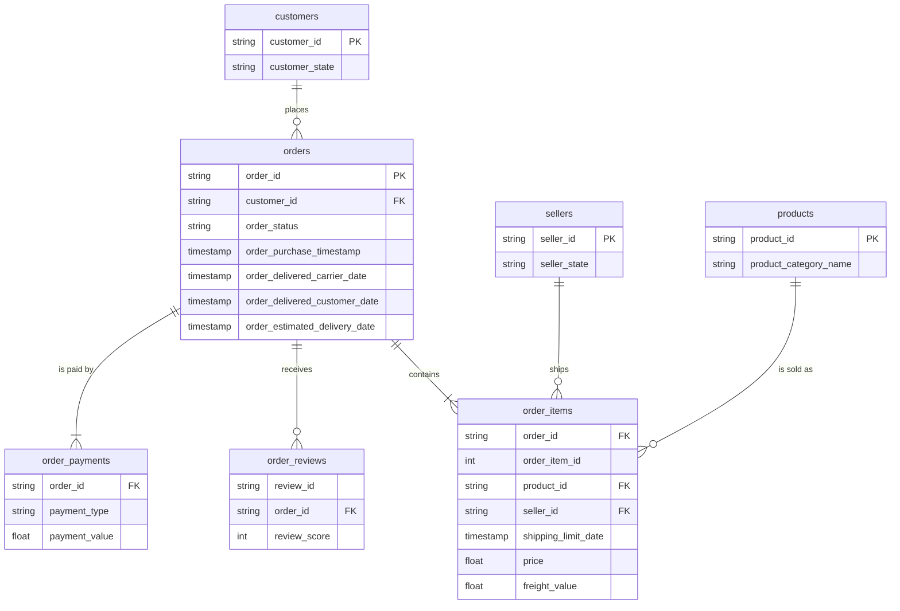

# Late Deliveries at Olist: Where to Fix Them First to Stop Bad Reviews

**SQL (BigQuery) · Excel (formulas, charts, what-if model) · E-commerce operations · Real data (96K orders)**

## 1. The business problem

Olist is a Brazilian marketplace that connects small sellers to large online stores. Sellers ship the orders, and carriers deliver them.
Only **6.8% of orders arrive after the date promised at checkout**, but those orders produce **1 in 3 of all bad (1–2 star) reviews**. Low ratings hurt the sellers and the marketplace's reputation.

> **Which late deliveries can Olist actually prevent, and what should the Operations team change first?**

## 2. Key insights and recommendations

| # | Insight (from the data) | Recommendation |
|---|---|---|
| 1 | **2 fixable causes = 29% of orders but 60% of late deliveries:** sellers who miss the handover deadline, and slow carriers in Rio de Janeiro + the Northeast. | Focus on these two levers instead of a general "deliver faster" goal. |
| 2 | **When a seller hands the parcel to the carrier after the deadline, the order is 3.9x more likely to be late** (20.8% vs 5.4%). A short list of sellers misses the deadline on 35–60% of their orders. | **Enforce the handover deadline:** warn sellers who miss it on more than 25% of orders (list in the Excel *Seller Scorecard*), and penalise repeat offenders. |
| 3 | **Rio de Janeiro is next to São Paulo but is late 12.1% of the time** (São Paulo: 4.5%). Rio + the Northeast are **22% of orders but 40% of late orders**, and late orders there spend about 36 days with the carrier. | **Add a second carrier or regional partner for Rio and the Northeast**, and give it an on-time target in the contract. |
| 4 | **Late % jumps to 12% in Nov 2017 (Black Friday) and 14–19% in Feb–Mar 2018.** Carrier transit time rose by ~50% while the promised date stayed the same. | **Add a peak-season buffer** to the estimated delivery date when carrier transit times rise. |
| 5 | **A late order loses 2 stars on average** (4.29 → 2.27). From 4 days late, 2 out of 3 reviews are bad. | Send a **proactive apology + voucher** as soon as an order passes its estimated date, before the customer writes the review. |

**Impact:** halving missed seller deadlines and closing half the Rio + Northeast gap would cut late deliveries from **6.8% to 5.4%** (~1,360 fewer late orders and ~720 fewer bad reviews over the period). The assumptions can be changed in the Excel *Scenario* sheet.



**Open the analysis:** [Excel workbook](excel/Olist_Late_Deliveries.xlsx) (download it, start from the *Summary* sheet) · [SQL queries](sql/)

## Table of contents

1. [The business problem](#1-the-business-problem)
2. [Key insights and recommendations](#2-key-insights-and-recommendations)
3. [The data](#3-the-data)
4. [Tools](#4-tools)
5. [Data model](#5-data-model)
6. [Method and steps](#6-method-and-steps)
7. [Excel workbook](#7-excel-workbook)
8. [Folder structure and how to run](#8-folder-structure-and-how-to-run)
9. [Limitations and next steps](#9-limitations-and-next-steps)

## 3. The data

**Source:** [Olist Brazilian E-Commerce Public Dataset](https://github.com/olist/work-at-olist-data), real anonymised orders from Olist, published by the company under the MIT License. Period: Sep 2016 – Oct 2018.

| Table | Rows | One row is |
|---|---:|---|
| `orders` | 99,441 | an order, with purchase / carrier pickup / delivery / estimated dates |
| `order_items` | 112,650 | a product in an order, with seller, price, freight and the seller's handover deadline (`shipping_limit_date`) |
| `order_reviews` | 99,224 | a customer review (1–5 stars) |
| `order_payments` | 103,886 | a payment |
| `customers` | 99,441 | a customer, with city and state |
| `sellers` | 3,095 | a seller, with city and state |
| `products` | 32,951 | a product, with category and size |
| `category_translation` | 71 | Portuguese → English category name |

**Definitions used everywhere**
- **Late** = delivered to the customer after the estimated delivery date shown at checkout (compared as calendar dates).
- **Seller missed deadline** = handed to the carrier after `shipping_limit_date`.
- **Bad review** = average score of 1 or 2 stars.

**Cleaning:** only `delivered` orders with delivery dates are analysed (96,469 orders). Orders with several reviews use the average score. Line breaks inside review comments were replaced with spaces so the CSV uploads cleanly. The geolocation table (61 MB) was not used and is not included.

## 4. Tools

- **SQL (Google BigQuery, Standard SQL):** joins across 4–5 tables, CTEs, window functions (`SUM() OVER`), conditional aggregation (`COUNTIF`, `CASE`), date and timestamp functions.
- **Excel:** `COUNTIFS` / `SUMIFS` / `AVERAGEIFS` analysis sheets over 96K rows, an Excel Table ready for PivotTables, conditional-formatting heatmaps, charts, and a what-if scenario model with editable assumptions.

## 5. Data model



## 6. Method and steps

Each SQL file answers one business question and starts with a comment explaining it.

| Step | File | Question it answers |
|---|---|---|
| 0 | [`00_data_quality.sql`](sql/00_data_quality.sql) | Can we trust the data, and what do we need to clean? |
| 1 | [`01_kpi_overview.sql`](sql/01_kpi_overview.sql) | How often are orders late, and how long do customers wait? |
| 2 | [`02_late_delivery_vs_reviews.sql`](sql/02_late_delivery_vs_reviews.sql) | What does a late delivery do to the review score? |
| 3 | [`03_late_by_state.sql`](sql/03_late_by_state.sql) | Where are customers waiting too long? |
| 4 | [`04_seller_vs_carrier.sql`](sql/04_seller_vs_carrier.sql) | Who causes the delay: the seller or the carrier? |
| 5 | [`05_seller_scorecard.sql`](sql/05_seller_scorecard.sql) | Which sellers repeatedly miss the handover deadline? |
| 6 | [`06_monthly_trend.sql`](sql/06_monthly_trend.sql) | When does lateness spike, and which stage slows down? |
| 7 | [`07_impact_estimate.sql`](sql/07_impact_estimate.sql) | How much of the problem does each lever explain? |

The Excel workbook rebuilds the same numbers independently with formulas, so SQL and Excel check each other.

## 7. Excel workbook

[`excel/Olist_Late_Deliveries.xlsx`](excel/Olist_Late_Deliveries.xlsx), every number is a live formula:

| Sheet | What it shows |
|---|---|
| **Summary** | Key numbers, the 5 recommendations, links to every sheet |
| **Reviews** | Review score and bad-review % by days late + chart |
| **States** | Late % heatmap by customer state |
| **Root Cause** | Days in the seller stage vs. the carrier stage; late % when the seller misses the deadline |
| **Seller Scorecard** | Worst 20 sellers, with a warning flag driven by an editable threshold |
| **Monthly Trend** | Late %, carrier days and promised days by month + charts |
| **Scenario** | What-if model: change the blue cells and the late orders and bad reviews avoided update |
| **Data** | 96,469 delivered orders as an Excel Table, ready for PivotTables |

## 8. Folder structure and how to run

```
olist-late-deliveries/
├── README.md
├── data/        8 CSV files (the tables above)
├── sql/         8 SQL files, run in order 00 → 07
├── excel/       Olist_Late_Deliveries.xlsx
├── images/      chart used in this README
└── scripts/     Python used to build the workbook and the chart (optional)
```

**Run the SQL in BigQuery (no installation, free sandbox):**
1. Open [BigQuery](https://console.cloud.google.com/bigquery) and create a dataset named `olist`.
2. For each CSV in `data/`: *Create table → Upload*, choose the file, name the table like the file (e.g. `orders`), and tick **Auto detect** for the schema.
3. Open any file from `sql/`, paste it into the query editor and click **Run**.

**Excel:** download and open the workbook. No setup needed.

## 9. Limitations and next steps

- The data does not name the carrier, so "carrier delay" means time between pickup and delivery; it could also include last-mile or address problems.
- The link between late delivery and bad reviews is a strong correlation, not proof of cause; an A/B test of the proactive voucher would measure the real effect.
- Next step: an interactive Looker Studio dashboard on top of the BigQuery tables, so Operations can track late % by state and seller every week.

---

**Author:** Guy · [LinkedIn](https://www.linkedin.com/in/YOUR-PROFILE) · [Email](mailto:YOUR-EMAIL) · Project date: November 2026
